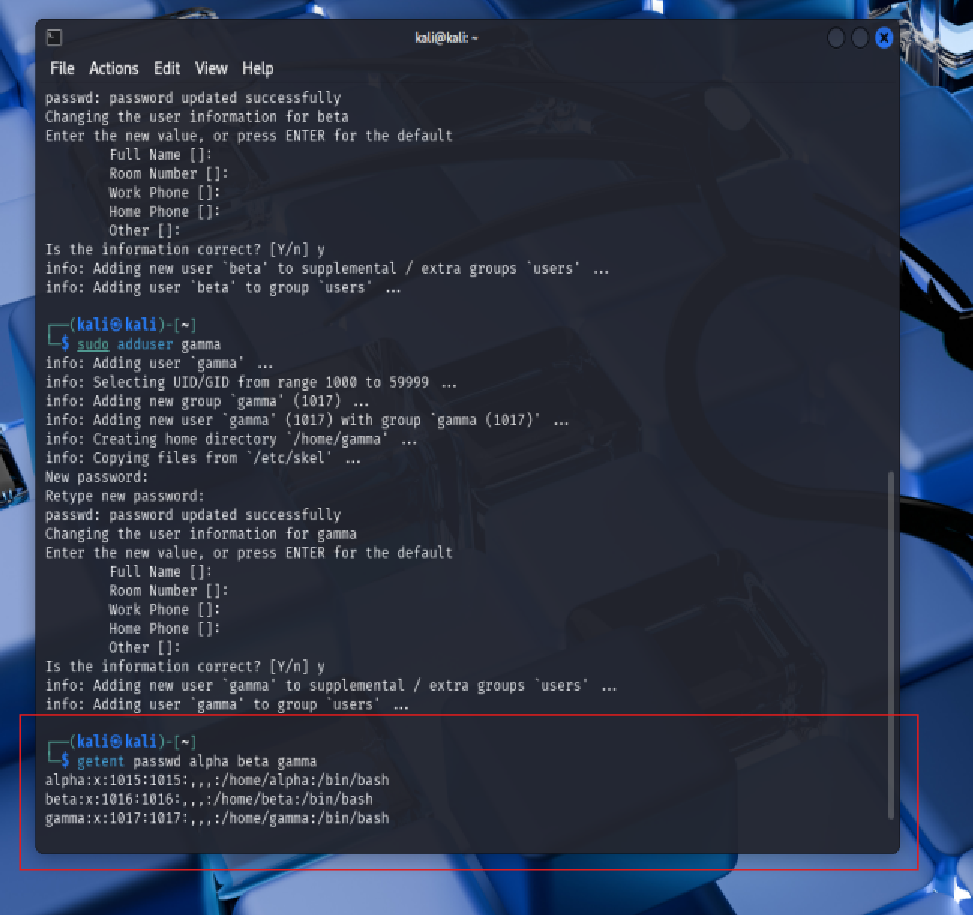
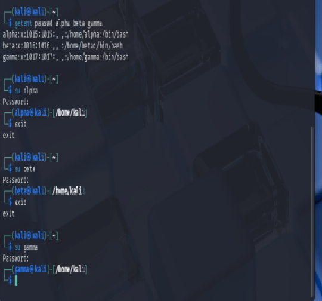
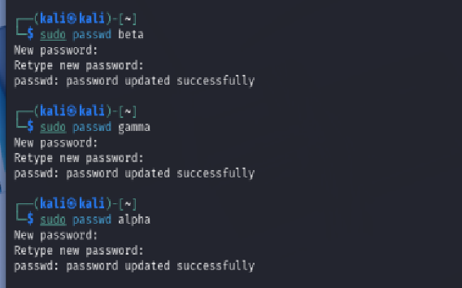
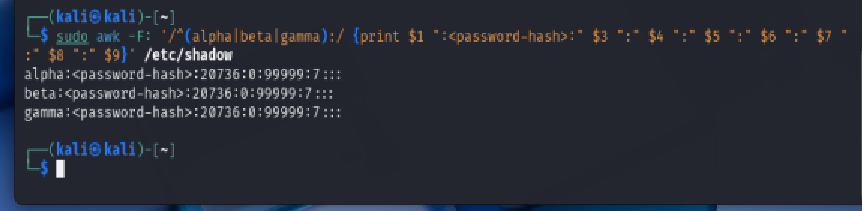
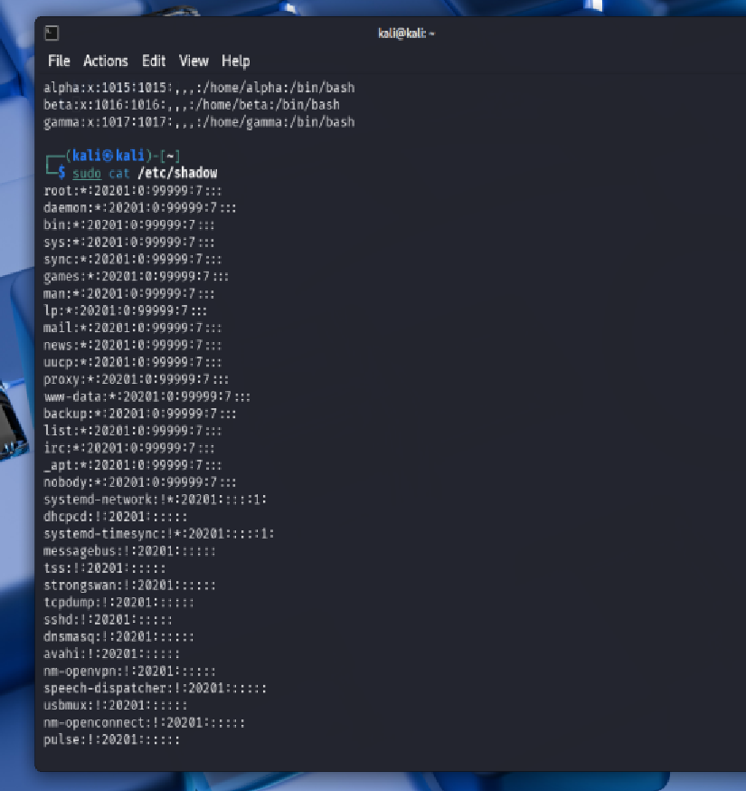

# Week 7 – Authentication and Password Security

## Overview

I worked with Linux user authentication and password security.

The practical activities focused on:

- creating Linux user accounts
- changing user passwords
- reviewing the CQUniversity ICT Passwords Procedure
- examining `/etc/passwd`
- examining `/etc/shadow`
- understanding how Linux stores password information securely

The tutorial helped me understand the relationship between user accounts, password policies, password hashing, salts and secure authentication storage.

---

# Task 1 – Create Users

## Objective

The objective of this task was to create three Linux users, configure passwords for them, test user login and then change their passwords using the `passwd` command.

The tutorial required two users to have the same password and the third user to have a different password.

---

## Creating the Users

I created three users in Kali Linux:

- `alpha`
- `beta`
- `gamma`

Commands used:

`sudo adduser alpha`

`sudo adduser beta`

`sudo adduser gamma`

I configured `alpha` and `beta` with the same lab password and configured `gamma` with a different password.

After creating the users, I confirmed the accounts using:

`getent passwd alpha beta gamma`

The output showed all three user accounts and their corresponding home directories and login shells.

*Figure 1: Linux users alpha, beta and gamma successfully created and listed.*

---

## Testing User Login

I tested each user account using the `su` command.

Commands used:

`su alpha`

`su beta`

`su gamma`

After each successful login, the shell prompt changed to the corresponding user account.

*Figure 2: Successful login tests for alpha, beta and gamma.*

---

## Changing User Passwords

I changed the passwords using the `passwd` command.

Commands used:

`sudo passwd alpha`

`sudo passwd beta`

`sudo passwd gamma`

The passwords were configured so that:

- `alpha` and `beta` used the same lab password
- `gamma` used a different lab password

All three password changes completed successfully.

*Figure 3: Successful password changes for alpha, beta and gamma.*

---

## Task 1 Result

I successfully created three Linux users, tested their logins and changed their passwords.

This task demonstrated how Linux user accounts can be created and managed using `adduser`, `su` and `passwd`.

---

# Task 2 – Password Policies

## Objective

The objective of this task was to review the CQUniversity ICT Passwords Procedure and examine how password controls balance security and user convenience.

The procedure includes password requirements, password reuse restrictions, account lockout controls, password protection requirements and multi-factor authentication. 

---

## Security and Convenience Trade-off

The CQUniversity procedure includes several controls designed to improve password security.

Examples include:

- users cannot reuse a password used in their last 13 passwords or within the last five years
- weak and commonly known passwords are not permitted
- user accounts are locked for 30 minutes after five consecutive incorrect password attempts
- users with multiple University accounts must use unique passwords
- University passwords must not be reused for non-University accounts
- multi-factor authentication must be used where supported 

These controls improve security by reducing the risk of password guessing, password reuse and account compromise.

---

## Password Protection

The procedure states that users must not:

- reveal passwords to other people
- insert passwords into email messages
- write passwords down and store them insecurely
- use some application “remember password” features 

If recording a password is necessary, it must be stored in an approved password safe.

These requirements improve security but may create some inconvenience for users who prefer easier password storage methods.

---

## Accessibility and Exceptions

Section 3.8 of the procedure allows exceptions to the password protection requirements for accessibility or equity scenarios.

Where a password is revealed under such circumstances, responsibility for the security of the password remains with the account holder.

---

## Do Users Follow All Recommendations?

It is unlikely that every user follows every password recommendation consistently.

Some users may choose convenience over security by:

- reusing passwords
- selecting easier passwords
- saving passwords insecurely
- relying on browser password-saving features

This demonstrates why password policies must combine technical controls with user education.

---

## Task 2 Result

This task showed that password policies must balance strong security controls with usability.

Controls such as password restrictions, lockout mechanisms and MFA improve security, but they can also create additional effort for users.

---

# Task 3 – Password Storage in Linux

## Objective

The objective of this task was to examine the Linux `/etc/passwd` and `/etc/shadow` files and understand how user account information and password authentication data are stored.

The tutorial specifically required examining both files and explaining their structure, password storage method, algorithms and security benefits. 

---

## `/etc/passwd`

I examined the `/etc/passwd` file and displayed the entries for the three users created in Task 1.

Command used:

`grep -E '^(alpha|beta|gamma):' /etc/passwd`

The general structure of `/etc/passwd` is:

`username:password:UID:GID:comment:home_directory:shell`

The `x` in the password field indicates that the actual password hash is stored separately in `/etc/shadow`. 

*Figure 4: `/etc/passwd` entries for alpha, beta and gamma.*

---

## `/etc/shadow`

The `/etc/shadow` file stores secure authentication information and is normally restricted to privileged users.

Its general structure is:

`username:password:last_change:min:max:warn:inactive:expire:reserved` 

For the public GitHub journal, I masked the actual password hashes before taking the screenshot.

*Figure 5: Masked `/etc/shadow` entries for alpha, beta and gamma.*

---

## Password Hashing

Linux does not store plaintext passwords.

The password field in `/etc/shadow` contains a password hash.

The supplied tutorial explanation describes the general format as:

`$id$salt$hashed_password`

where:

- `id` identifies the hashing algorithm
- `salt` is a random value added before hashing
- `hashed_password` is the resulting password hash 

On my Kali system, the password hashes started with:

`$y$`

This indicates that the system is using **yescrypt** for password hashing.

The use of a salt means that users with the same password can still have different stored password hashes.

---

## Security Benefits

The Linux password-storage design provides several security benefits.

### Separation of information

`/etc/passwd` contains general account information and can be read by normal users.

`/etc/shadow` contains password authentication data and is restricted to privileged users. 

### Password hashing

Passwords are stored as one-way hashes rather than plaintext.

This means the original password is not directly stored in the system.

### Salting

A salt is included in password hashing.

This helps prevent attackers from using precomputed rainbow tables and ensures that identical passwords can generate different hashes. 

---

## Task 3 Result

I examined both `/etc/passwd` and `/etc/shadow` and confirmed that Linux separates general account information from sensitive password authentication data.

The system stores salted password hashes instead of plaintext passwords and restricts access to `/etc/shadow`.

This design improves the security of Linux user authentication.

---

# Week 7 Outcome

In this Week, I learned how Linux user authentication is managed through user accounts, password policies and secure password storage.

I created and tested Linux user accounts, changed their passwords, reviewed the CQUniversity ICT Passwords Procedure, and examined the structure of `/etc/passwd` and `/etc/shadow`.

The practical work demonstrated how Linux protects password information using restricted access, password hashing and salts, while organisational password policies provide additional controls such as password restrictions, account lockout and multi-factor authentication.
