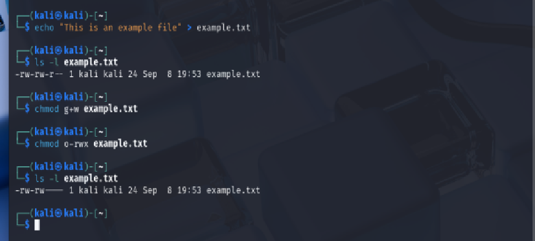
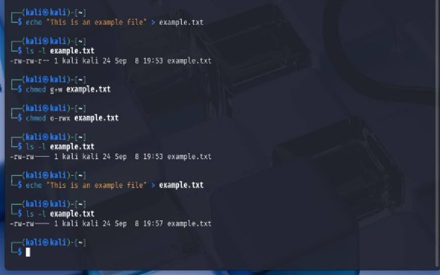
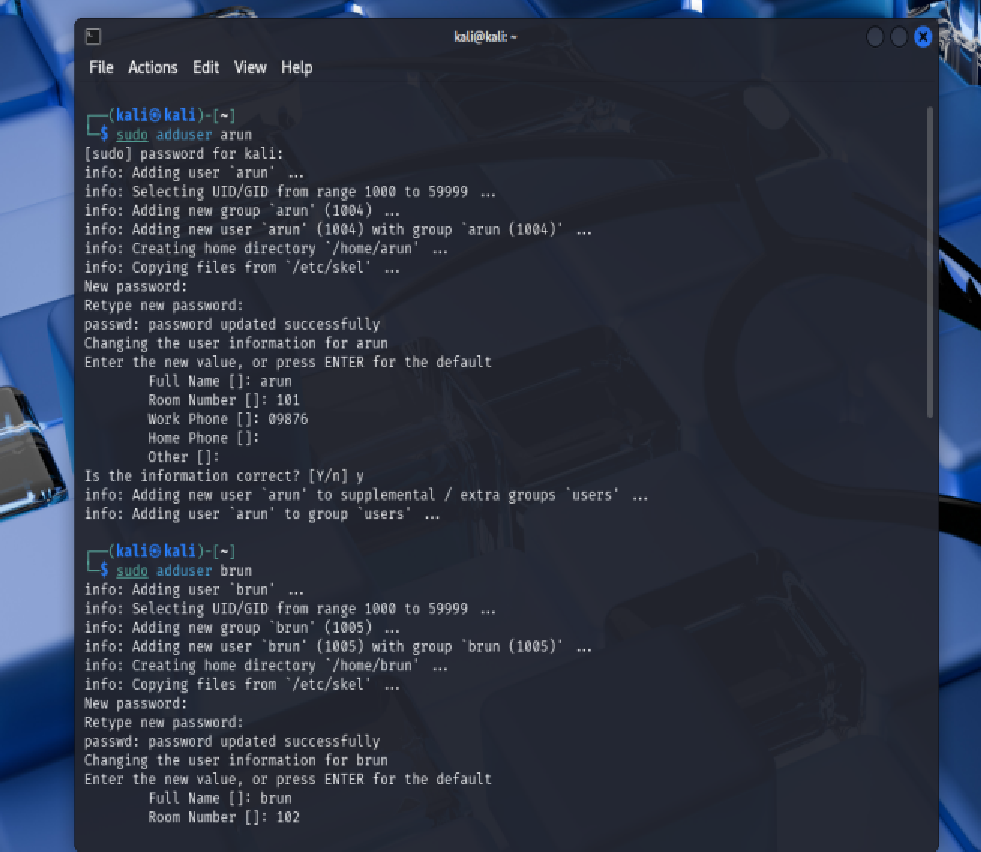
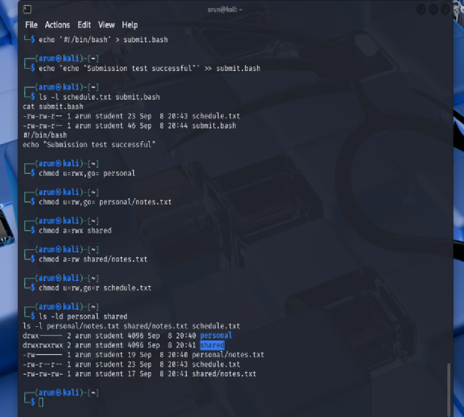
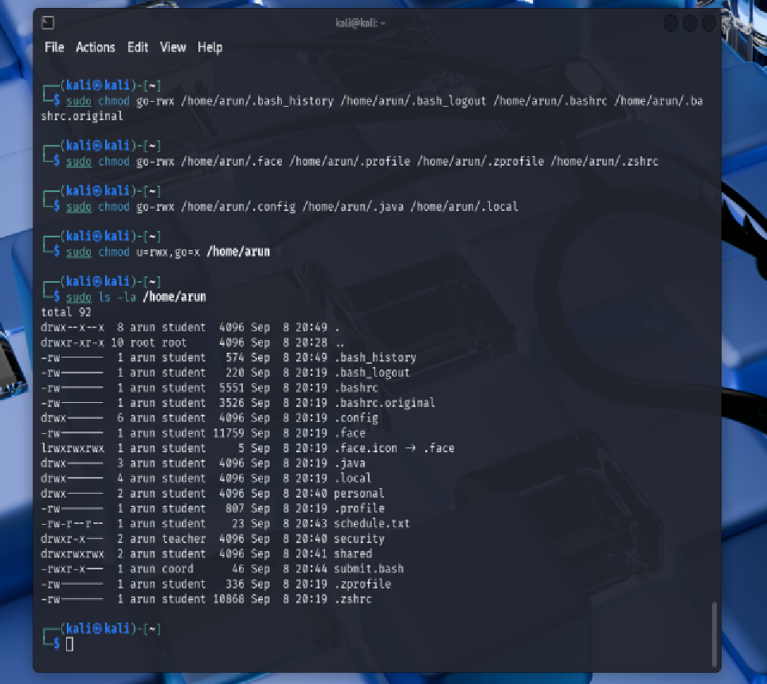
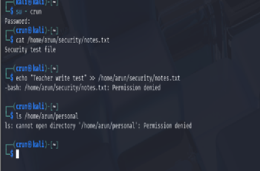

# Week 8 – Access Control and File Permissions

## Overview
In this week tutorial focused on:

- creating and examining file permissions
- modifying permissions using `chmod`
- controlling access for the file owner, group and other users
- applying access-control rules to user directories and files
- testing permitted and denied access
- discussing the limitations of Linux `rwx` permissions

The practical activities helped me understand how Linux implements discretionary access control using users, groups and file permission bits.

---

# Task 1 – File Permissions

## Objective

The objective of this task was to create an example file, inspect its permissions, and modify the permissions so that group users could write to the file while other users had no access.

The tutorial required the use of `ls -l` and `chmod` to examine and modify file permissions. 

---

## Creating the Example File

I created an example file in my Kali Linux home directory using:

`echo "This is an example file" > example.txt`

I then viewed the file permissions using:

`ls -l example.txt`

The output showed the permissions assigned to:

- the file owner
- the group
- other users

*Figure 1: Creation of example.txt and inspection of its initial Linux file permissions.*

---

## Modifying Group and Other Permissions

I modified the permissions so that users in the group could write to the file.

Command used:

`chmod g+w example.txt`

I then removed all permissions for other users using:

`chmod o-rwx example.txt`

After checking the file again with:

`ls -l example.txt`

the resulting permissions were:

`-rw-rw----`

This means:

- owner: read and write
- group: read and write
- others: no permissions

*Figure 2: Final permissions allowing owner and group read/write access while denying all access to other users.*

---

## Task 1 Result

The file permissions were successfully modified according to the tutorial requirements.

This task demonstrated how symbolic permission changes such as `g+w` and `o-rwx` can be used to control access to files.

---

# Task 2 – Access Control Policy

## Objective

The objective of this task was to apply Linux file permissions to implement an access-control policy using multiple users, directories and files.

The tutorial required the use of user-management commands together with file permissions to implement the policy. 

---

## Creating Users

I created additional Linux users using the `adduser` command.

Examples included users such as:

- `arun`
- `brun`

These accounts were used to test how access permissions affect different users.

*Figure 3: Creation of additional Linux users for the access-control activity.*

---

## Creating Directories and Files

For the user `arun`, I created directories including:

- `personal`
- `security`
- `shared`

I also created example files inside these directories to test different access conditions.

Examples included:

`security/notes.txt`

`personal/notes.txt`

`shared/notes.txt`

The directory and file structure was then inspected using recursive listing commands.

*Figure 4: User directories and example files created for access-control testing.*

---

## Applying File Permissions

I applied Linux permission settings using `chmod`.

Different combinations of owner, group and other permissions were used depending on the intended access.

Examples included:

`chmod u=rwx,g= personal`

`chmod u=rw,g= personal/notes.txt`

`chmod a=rwx shared`

`chmod a=rw shared/notes.txt`

I then checked the resulting permissions using:

`ls -ld`

and

`ls -l`

*Figure 5: File and directory permissions configured for the access-control policy.*

---

## Testing Access as Another User

I tested the configured permissions by switching to another user and attempting to access files and directories.

Some resources could be read successfully, while unauthorised write or directory access attempts returned:

`Permission denied`

This demonstrated that Linux enforced the configured file permission restrictions.

*Figure 6: Access-control test showing permission denied for an unauthorised operation.*

---

# Discussion – Limitations of Linux File Permissions

Linux traditional file permissions use three classes:

- user
- group
- others

and three basic permissions:

- read (`r`)
- write (`w`)
- execute (`x`)

This system is simple and effective for many access-control requirements.

However, it has limitations.

## Limited Number of Permission Classes

Traditional Linux permissions only distinguish between the owner, one group and all other users.

If an organisation requires different permissions for several individual users or multiple groups, basic `rwx` permissions may not provide enough granularity.

## Group Membership Dependency

Access is strongly dependent on group membership.

If a user belongs to a group that has permission to a resource, that user receives the group's access even if the policy intended a more specific restriction.

## Directory and File Permissions Are Different

Permissions on a directory and permissions on files inside the directory have different effects.

For example, directory execute permission controls whether a user can enter or traverse the directory, while file permissions control access to the individual file.

This can make access-control policies harder to interpret and configure correctly.

## Policy Ambiguity

An access-control policy may describe requirements using terms such as "access", "modify" or "use".

These terms can be ambiguous because Linux requires them to be translated into specific combinations of `r`, `w` and `x`.

For example, "access a directory" may require execute permission, while "view files inside a directory" may require both read and execute permissions.

## Are Linux rwx Permissions Sufficient?

For simple policies, Linux `rwx` permissions are generally sufficient.

They work well where access can be divided into:

- owner
- group
- everyone else

For more complex policies, additional mechanisms may be required, such as:

- Access Control Lists (ACLs)
- more carefully designed Unix groups
- application-level access controls

Therefore, basic Linux permissions provide a useful foundation for access control, but they may not be sufficient for policies requiring fine-grained permissions for many different users.

---

# Week 8 Outcome

In Week 8, I learned how Linux access control is implemented using file ownership, groups and `rwx` permissions.

I created and modified file permissions, configured directories and files for different access requirements, and tested access using different users.

The practical work demonstrated that Linux file permissions can effectively enforce simple access-control policies, while the theoretical discussion showed that traditional `rwx` permissions have limitations when more detailed or user-specific access control is required.
