# Week 9 – Digital Certificates and Secure Web Server

## Overview

In Week 9, I worked with digital certificates, Certificate Authorities (CAs), HTTPS and Apache web-server security.

The tutorial consisted of two main tasks:

- analysing digital certificates and trusted root certificates
- deploying a secure HTTPS web server in virtnet

The practical work helped me understand how certificate trust works, how a Certificate Authority signs a server certificate, how Apache is configured for HTTPS, and how a client verifies a server certificate.

---

# Task 1 – Analyse Digital Certificates

## Objective

The objective of this task was to examine trusted root certificates stored by the browser/operating system and analyse a certificate used by a real HTTPS website.

I inspected:

- a trusted root CA certificate
- a website certificate
- certificate issuer information
- validity periods
- SHA-256 fingerprints
- certificate trust relationships

---

## Root Certificate Analysis

I opened the certificate manager in Chrome and examined a trusted root certificate.

The root certificate selected was:

`Amazon Root CA 1`

The certificate showed:

- Common Name: Amazon Root CA 1
- Organisation: Amazon
- Issued To: Amazon Root CA 1
- Issued By: Amazon Root CA 1
- certificate validity period
- SHA-256 certificate fingerprint
- SHA-256 public-key fingerprint

Because the **Issued To** and **Issued By** fields were the same, the certificate was self-signed. This is expected for a root Certificate Authority.

---

## Website Certificate Analysis

I then inspected the HTTPS certificate for:

`www.cqu.edu.au`

The certificate showed that:

- the certificate was issued to `www.cqu.edu.au`
- the issuer was `WE1`
- the issuer organisation was Google Trust Services
- the certificate had a defined validity period
- SHA-256 fingerprints were provided

Unlike the root certificate, the website certificate was not self-signed because its issuer was different from the website identity.

This demonstrates how a website certificate is validated through a chain of trust that ultimately leads to a trusted root CA.

---

## Discussion – Trust in Certificate Authorities

Root Certificate Authorities are trusted because their root certificates are included in the trusted certificate stores used by browsers and operating systems.

However, this trust is not absolute.

If a trusted CA is compromised or incorrectly issues a certificate, an attacker could potentially obtain a certificate that browsers accept as valid.

For this reason, operating systems and browsers:

- maintain trusted root certificate stores
- remove or distrust problematic CAs
- check certificate validity
- verify certificate chains
- use certificate revocation mechanisms where supported

Therefore, the security of HTTPS depends not only on encryption but also on the reliability and security practices of Certificate Authorities.

---

# Task 2 – Deploy a Secure Web Server

## Objective

The objective of this task was to configure an Apache web server on node3 to use HTTPS with a custom Certificate Authority.

The virtnet topology used was:

- node1 – client
- node2 – router
- node3 – Apache web server

The major steps included:

- testing Apache over HTTP
- creating a Certificate Authority
- configuring the CA directory structure
- configuring the CA policy
- creating a server private key
- creating a Certificate Signing Request
- signing the server certificate
- verifying the certificate
- enabling Apache SSL
- testing HTTPS from node1
- verifying the certificate chain from the client

---

## Step 1 – Verify Apache Web Server

On node3, I checked that Apache was running.

Command used:

`sudo systemctl status apache2`

The output showed:

`Active: active (running)`

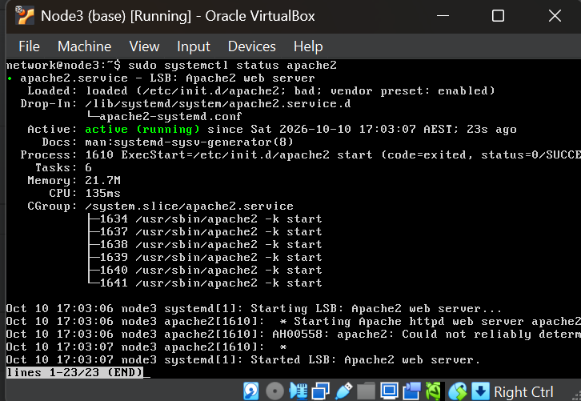

*Figure 1: Apache web server running successfully on node3.*

---

## Step 2 – Test HTTP Before HTTPS

Before enabling HTTPS, I tested normal HTTP connectivity from node1.

The Apache default page successfully loaded using Lynx.

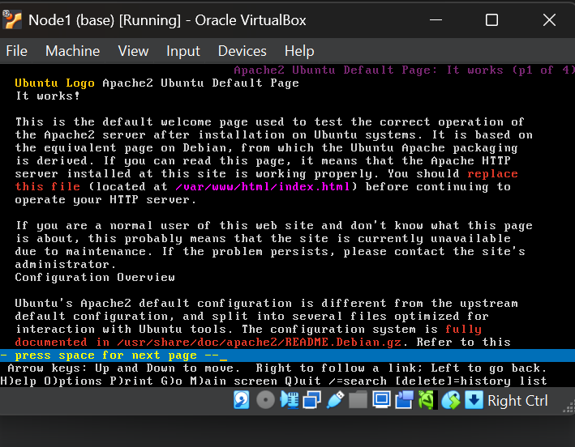

*Figure 2: Apache default page accessed from node1 before HTTPS configuration.*

---

## Step 3 – Create the Certificate Authority

On node3, I created an RSA private key for the Certificate Authority.

I then created a self-signed CA certificate.

The CA certificate included information such as:

- Country: AU
- State: QLD
- Locality: Brisbane
- Organisation: CQU
- Organisational Unit: Authority
- Common Name: MyUni CA

I verified that both files were successfully created:

- `cakey.pem`
- `cacert.pem`

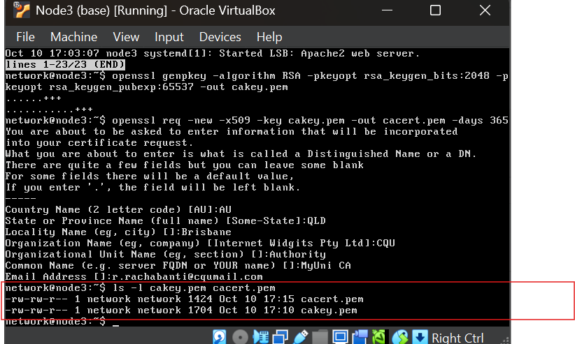

*Figure 3: CA private key and CA certificate successfully created.*

---

## Step 4 – Create the CA Directory Structure

I created the required CA directory structure:

- `demoCA/certs`
- `demoCA/crl`
- `demoCA/newcerts`
- `demoCA/private`
- `demoCA/index.txt`
- `demoCA/serial`

The CA certificate was stored in the main `demoCA` directory and the CA private key was stored in the private directory.

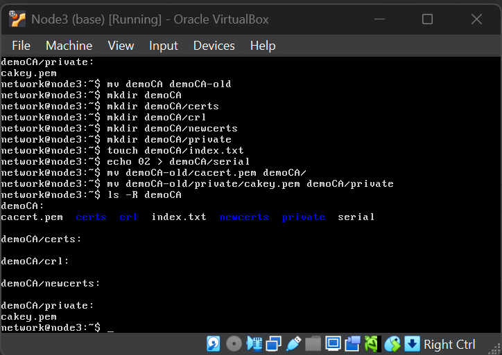

*Figure 4: Certificate Authority directory structure.*

---

## Step 5 – Configure the CA Policy

I edited the OpenSSL configuration file and configured the CA policy.

The important policy settings included:

`countryName = match`

`stateOrProvinceName = optional`

`organizationName = optional`

`organizationalUnitName = optional`

`commonName = supplied`

`emailAddress = optional`

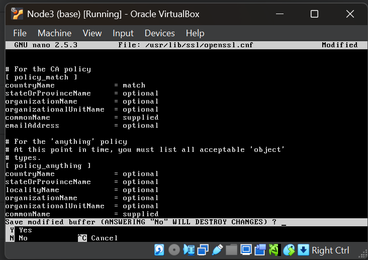

*Figure 5: OpenSSL CA policy configuration.*

---

## Step 6 – Create the Web Server Key and CSR

I generated a new RSA private key for the web server and then created a Certificate Signing Request.

The server hostname used was:

`www.myuni.edu`

The generated files were:

- `privkey-www.myuni.edu.pem`
- `certreq-www.myuni.edu.csr`

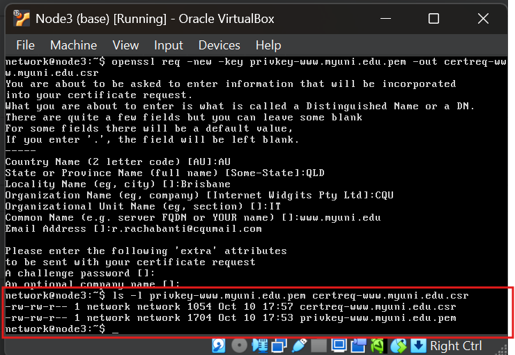

*Figure 6: Web-server private key and Certificate Signing Request successfully created.*

---

## Step 7 – Sign and Verify the Server Certificate

The CSR was signed using the custom Certificate Authority.

The server certificate was created as:

`cert-www.myuni.edu.pem`

I then verified the certificate against the CA using OpenSSL.

The result was:

`cert-www.myuni.edu.pem: OK`

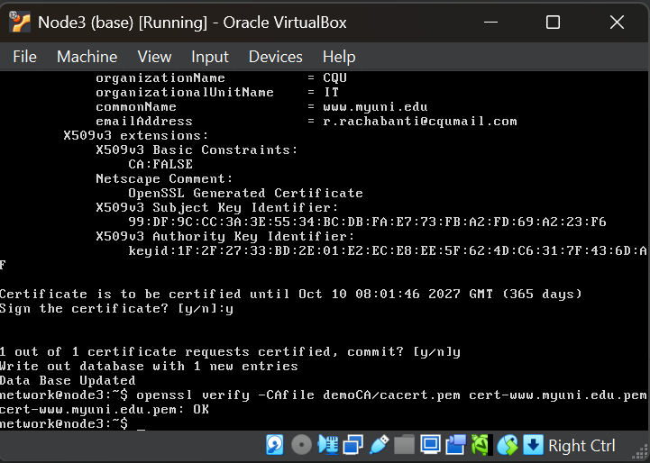

*Figure 7: Web-server certificate signed by the CA and successfully verified.*

---

## Step 8 – Enable HTTPS in Apache

I configured Apache to use the new HTTPS certificate and private key.

The SSL configuration used:

`ServerName www.myuni.edu`

`SSLCertificateFile /etc/ssl/certs/cert-www.myuni.edu.pem`

`SSLCertificateKeyFile /etc/ssl/private/privkey-www.myuni.edu.pem`

`SSLCACertificateFile /etc/ssl/certs/cert-ourca.crt`

I then enabled SSL and the default SSL site.

Apache was restarted successfully and showed:

`Active: active (running)`

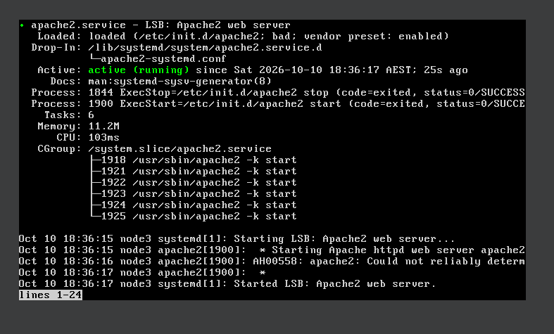

*Figure 8: Apache running successfully after HTTPS configuration.*

---

## Step 9 – Initial HTTPS Test

From node1, I tested:

`https://www.myuni.edu`

The HTTPS connection reached the web server, but Lynx initially displayed:

`The certificate is NOT trusted`

This occurred before the custom CA trust configuration was fully recognised by Lynx.

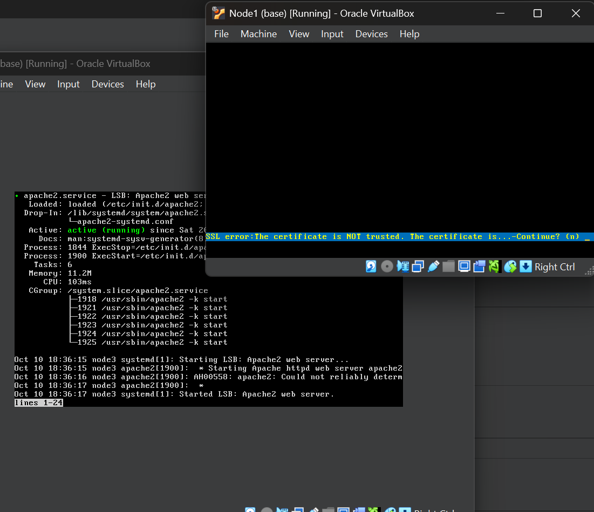

*Figure 9: Initial HTTPS connection showing certificate trust warning.*

---

## Step 10 – Verify the Certificate Chain

The client trust store was updated with the custom CA certificate.

I then used OpenSSL from node1 to verify the TLS certificate chain presented by the server.

The important result was:

`Verify return code: 0 (ok)`

This confirmed that:

- the server certificate was valid
- the certificate was correctly signed by the custom CA
- node1 trusted the CA
- the TLS certificate chain was successfully verified

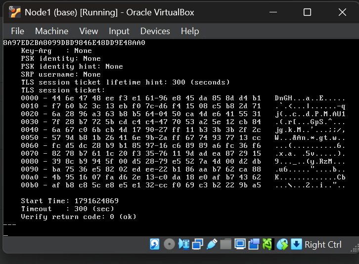

*Figure 10: OpenSSL verification returning code 0, confirming successful certificate validation.*

---

## Step 11 – Access the HTTPS Web Page

After certificate verification, I accessed the Apache web server over HTTPS using Lynx.

The Apache default page loaded successfully from node1.

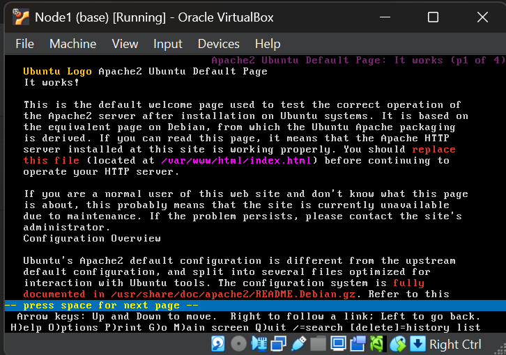

*Figure 11: Apache web page successfully loaded over HTTPS.*

An additional screenshot of the loaded page was also recorded.

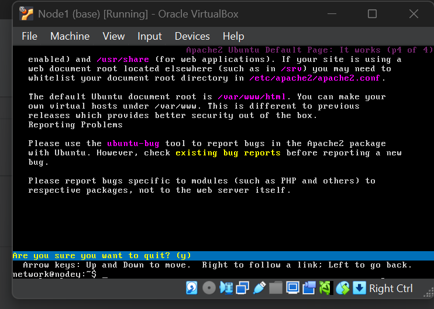

*Figure 12: Additional view of the HTTPS Apache page on node1.*

---

## Task 2 Result

The secure web-server deployment was completed successfully.

The final configuration demonstrated that:

- Apache was running on node3
- a custom Certificate Authority was created
- a web-server CSR was generated
- the CA signed the server certificate
- the certificate was verified successfully
- HTTPS was enabled in Apache
- the client connected to the server over HTTPS
- OpenSSL returned `Verify return code: 0 (ok)`
- the Apache web page was accessible through HTTPS

---

# Week 9 Outcome

In Week 9, I learned how Public Key Infrastructure and HTTPS work in practice.

The activities demonstrated the relationship between:

- root Certificate Authorities
- server certificates
- private keys
- Certificate Signing Requests
- certificate chains
- trusted CA stores
- Apache SSL configuration
- HTTPS client verification

The most important practical outcome was successfully creating a custom CA, issuing a certificate for `www.myuni.edu`, configuring Apache to use HTTPS, and verifying the certificate chain from node1 with OpenSSL.
