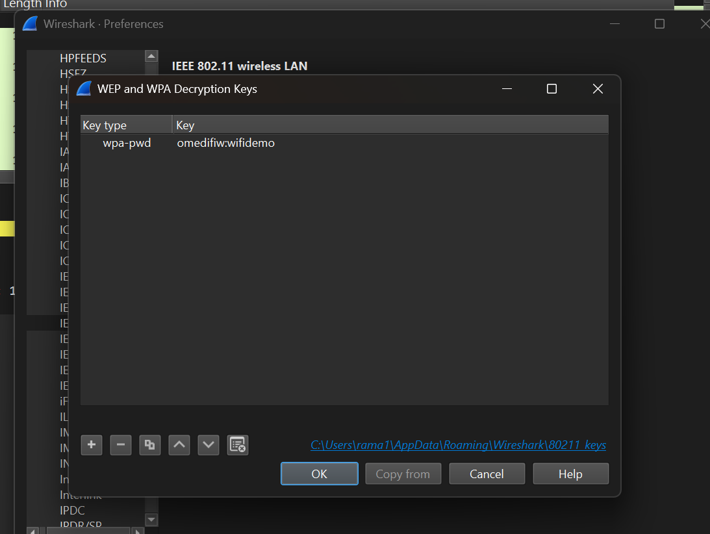
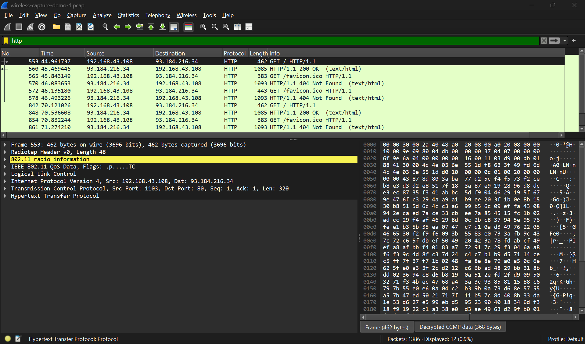
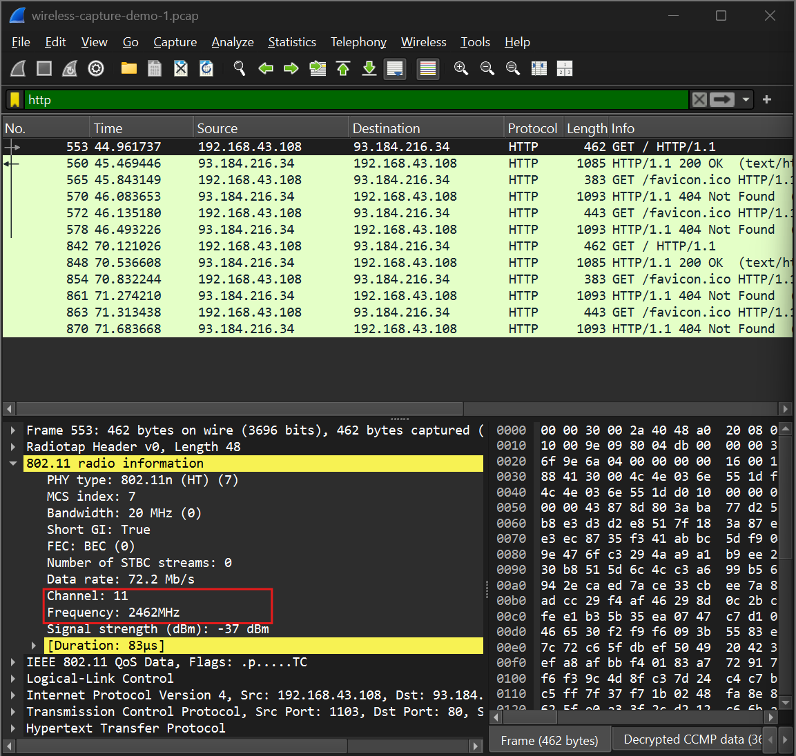
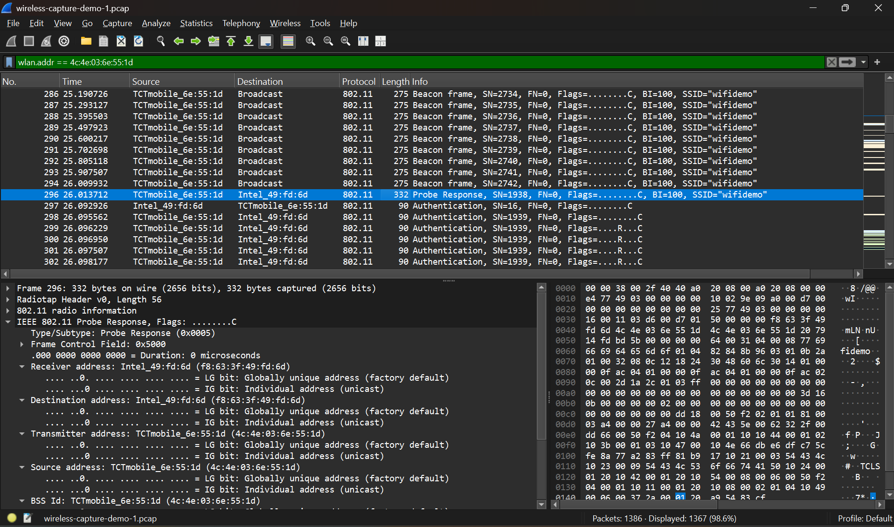
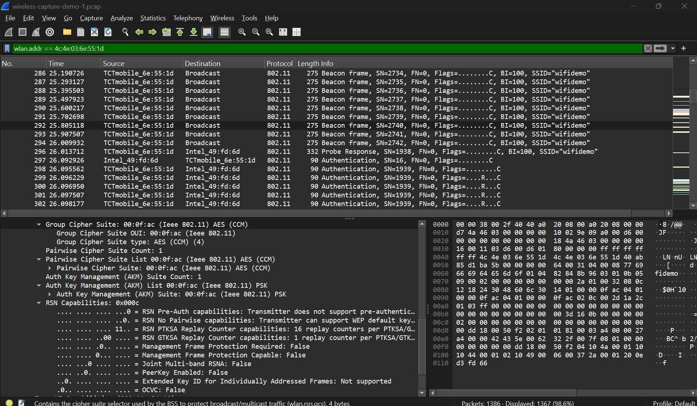
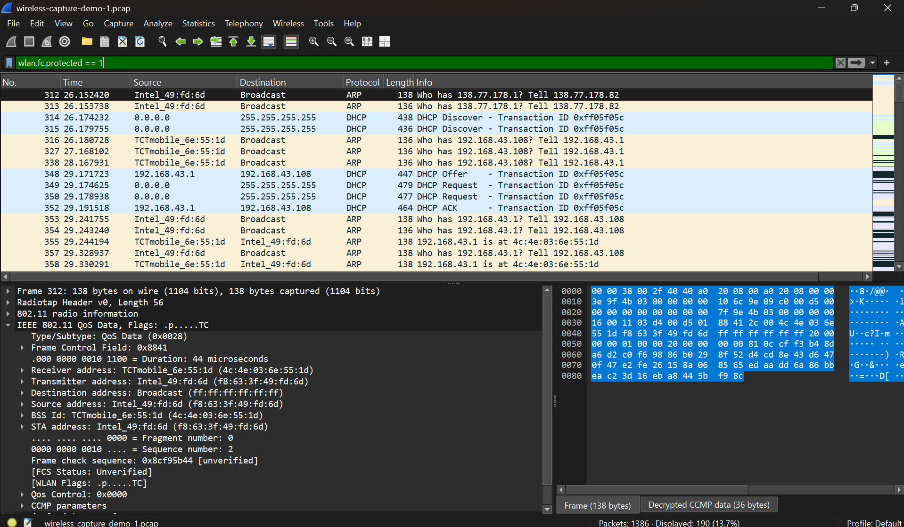
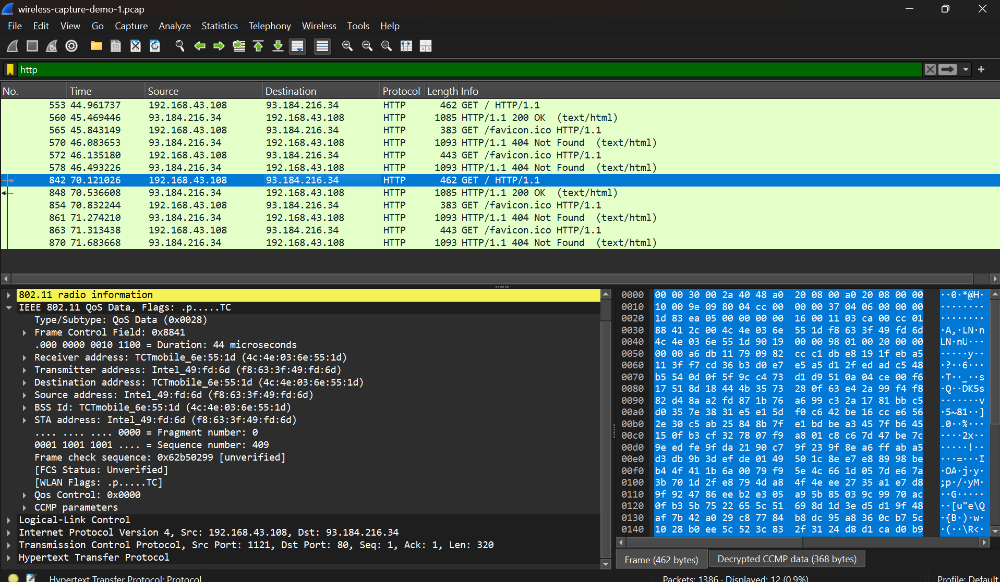
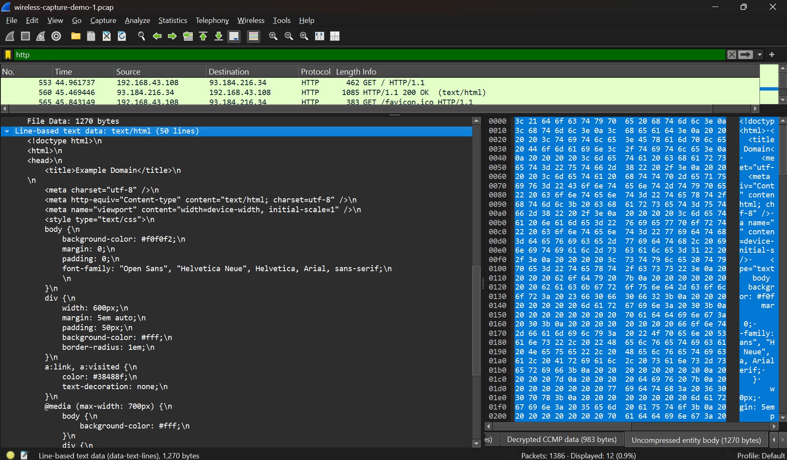
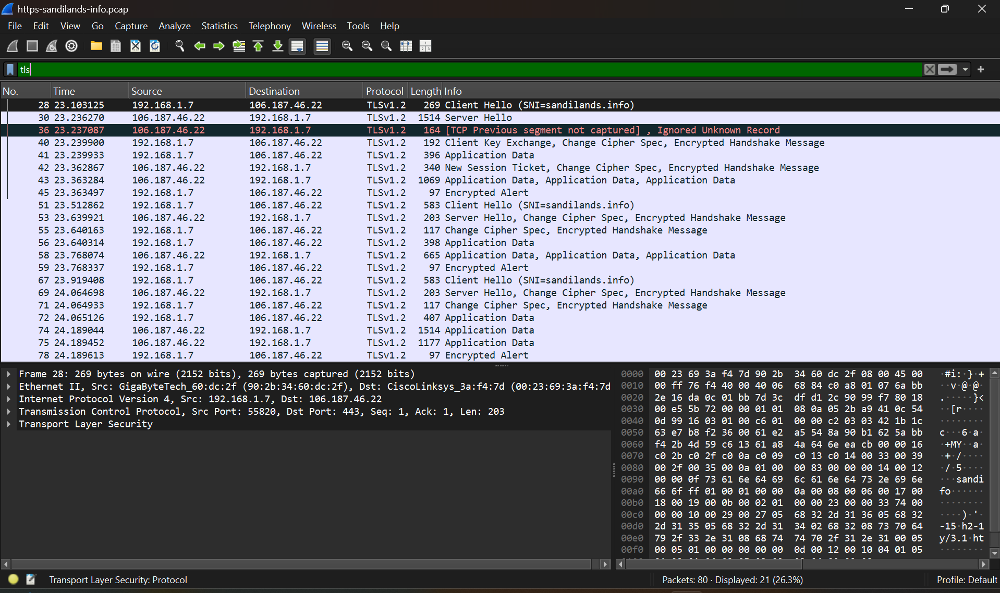
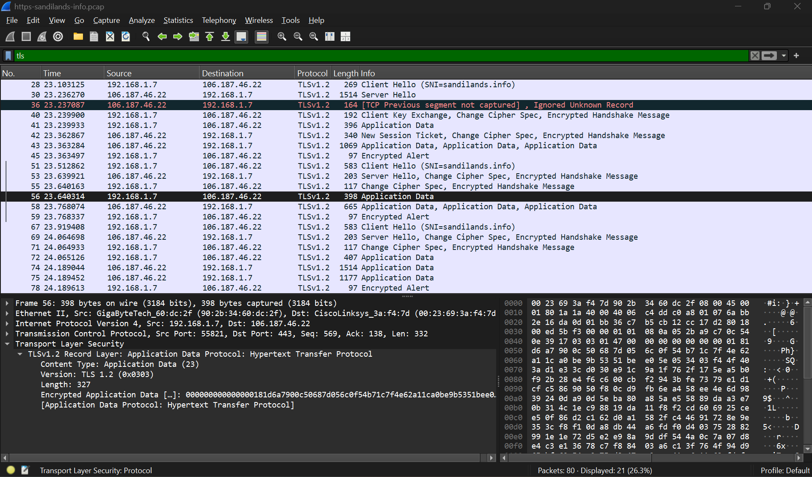

# Week 10 – Wireless Security and HTTPS Analysis

## Overview

I worked with wireless network security and packet analysis using Wireshark.

The main activities were:

- decrypting WPA2-protected wireless traffic
- analysing a wireless packet capture
- identifying the access point and client
- identifying channel, frequency and encryption details
- examining protected wireless frames
- analysing decrypted HTTP traffic
- comparing HTTP with HTTPS/TLS traffic

The supplied wireless capture file was:

`wireless-capture-demo-1.pcap`

The supplied HTTPS capture file was:

`https-sandilands-info.pcap`

---

# Task 1 – Decrypt WPA

## Objective

The objective of this task was to decrypt a supplied WPA2-protected wireless packet capture using Wireshark.

The wireless network SSID was:

`wifidemo`

The Wi-Fi password was the SSID written backwards:

`omedifiw`

In Wireshark, WPA decryption was configured using:

`Edit → Preferences → Protocols → IEEE 802.11 Wireless LAN`

The decryption key was entered using the format:

`omedifiw:wifidemo`

*Figure 1: WPA2 decryption key configured in Wireshark.*

After enabling decryption, Wireshark was able to decode the protected CCMP data and display higher-layer protocols such as HTTP.

*Figure 2: Decrypted HTTP traffic visible after enabling WPA2 decryption.*

## Task 1 Result

The WPA2 decryption was successful.

Wireshark displayed:

- decrypted CCMP data
- IP traffic
- TCP traffic
- HTTP GET requests
- HTTP responses

This demonstrated that wireless traffic protected using WPA2 can be analysed when the correct password and required handshake information are available.

---

# Task 2 – Analyse a Wireless Capture

## Objective

The objective of this task was to analyse the supplied wireless capture and identify important wireless network information.

The analysis included:

- Wi-Fi channel
- frequency
- access point MAC address
- client MAC address
- wireless security type
- encryption algorithm
- protected data frames
- website traffic
- web-page content

---

## Channel and Frequency

The 802.11 radio information showed:

- Channel: `11`
- Frequency: `2462 MHz`
- Frequency band: `2.4 GHz`

*Figure 3: Wireshark showing channel 11 and frequency 2462 MHz.*

---

## Access Point and Client Addresses

The access point and client MAC addresses were identified from the wireless frames.

- AP / BSSID: `4c:4e:03:6e:55:1d`
- Client MAC: `f8:63:3f:49:fd:6d`

The selected Probe Response frame showed:

- Receiver/Destination: client
- Transmitter/Source: access point
- BSSID: access point

*Figure 4: Access point and client MAC addresses in the wireless capture.*

---

## WPA2 Security Information

The RSN information in the wireless management frame showed:

- Group Cipher Suite: AES (CCM)
- Pairwise Cipher Suite: AES (CCM)
- Authentication and Key Management: PSK

This identifies the wireless network as:

`WPA2-Personal (WPA2-PSK) using AES/CCMP`

*Figure 5: RSN information showing AES/CCMP and PSK.*

---

## Protected Wireless Frames

The following Wireshark display filter was used:

`wlan.fc.protected == 1`

This displayed protected wireless frames exchanged between the client and access point.

*Figure 6: Protected wireless frames displayed in Wireshark.*

The selected frame also showed decrypted CCMP data, confirming that the wireless-layer encryption had been successfully removed for analysis.

---

## HTTP Traffic Analysis

After WPA2 decryption, I applied the following filter:

`http`

The capture showed communication between:

- Client IP: `192.168.43.108`
- Server IP: `93.184.216.34`

The traffic included:

- `GET / HTTP/1.1`
- `HTTP/1.1 200 OK`
- requests for `/favicon.ico`

*Figure 7: Decrypted HTTP communication between the client and web server.*

---

## Web Page Content

Because the website used plain HTTP rather than HTTPS, the returned web-page content could be read directly in Wireshark.

The HTML content included:

`<title>Example Domain</title>`

*Figure 8: HTTP web-page source visible in Wireshark.*

## Task 2 Result

The wireless capture analysis identified:

| Item | Finding |
|---|---|
| SSID | `wifidemo` |
| Channel | `11` |
| Frequency | `2462 MHz` |
| AP / BSSID | `4c:4e:03:6e:55:1d` |
| Client MAC | `f8:63:3f:49:fd:6d` |
| Security | WPA2-Personal / WPA2-PSK |
| Encryption | AES/CCMP |
| Client IP | `192.168.43.108` |
| Web Server IP | `93.184.216.34` |
| Application Protocol | HTTP |
| TCP Port | `80` |
| Web-page content visible | Yes |

---

# Task 3 – HTTPS and TLS Analysis

## Objective

Task 3 continued the secure web-server work from Week 9 and analysed HTTPS traffic using the supplied capture:

`https-sandilands-info.pcap`

A TLS display filter was applied:

`tls`

---

## TLS Traffic

The capture showed communication between:

- Client IP: `192.168.1.7`
- Server IP: `106.187.46.22`
- TLS version: `TLSv1.2`
- Server name: `sandilands.info`

The capture included:

- Client Hello
- Server Hello
- Client Key Exchange
- Change Cipher Spec
- Encrypted Handshake Message
- Application Data
- Encrypted Alert

*Figure 9: TLSv1.2 traffic for sandilands.info.*

---

## Encrypted Application Data

A TLS application-data packet was selected and expanded.

The packet showed:

- TCP destination port: `443`
- TLS version: `1.2`
- Content Type: Application Data
- Encrypted Application Data

*Figure 10: TLS application data showing encrypted HTTPS payload.*

Unlike the HTTP traffic analysed in Task 2, the actual HTTPS page content could not be read directly because the application payload was encrypted by TLS.

However, Wireshark could still display metadata such as:

- source and destination IP addresses
- TCP port 443
- packet lengths
- TLS version
- handshake messages
- SNI hostname

---

# HTTP vs HTTPS Comparison

| Feature | HTTP | HTTPS |
|---|---|---|
| Typical Port | 80 | 443 |
| Application Data | Plaintext | Encrypted |
| Web Content Visible in Wireshark | Yes | No |
| Encryption | None | TLS |
| Example from Capture | `www.example.com` | `sandilands.info` |

The comparison demonstrates why HTTPS provides stronger confidentiality than plain HTTP.

---

# Week 10 Outcome

In Week 10, I developed practical experience in wireless and web communication security.

The main outcomes were:

- configuring WPA2 decryption in Wireshark
- analysing IEEE 802.11 wireless frames
- identifying AP and client MAC addresses
- identifying Wi-Fi channel and frequency
- recognising WPA2-Personal security
- identifying AES/CCMP encryption
- examining protected wireless frames
- analysing decrypted HTTP traffic
- reading HTTP web-page content
- analysing TLSv1.2 communication
- observing encrypted HTTPS application data
- understanding the security difference between HTTP and HTTPS

The practical work demonstrated that WPA2 protects traffic over the wireless link, while HTTPS/TLS protects application data end-to-end.
